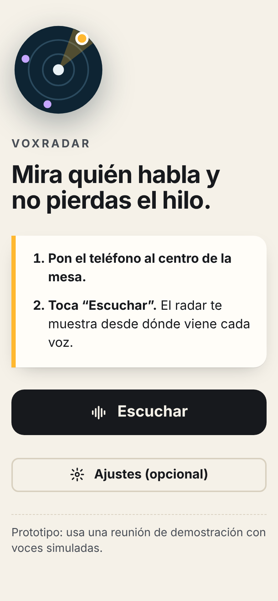
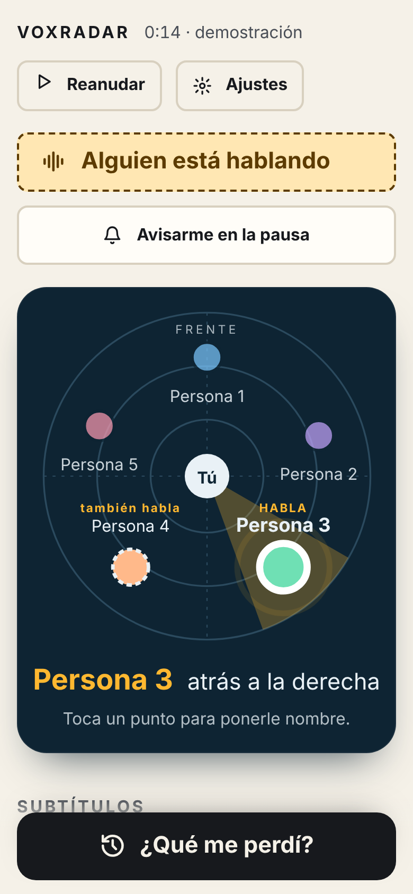
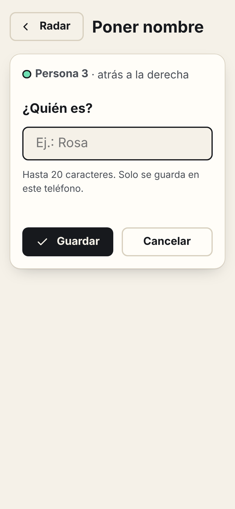
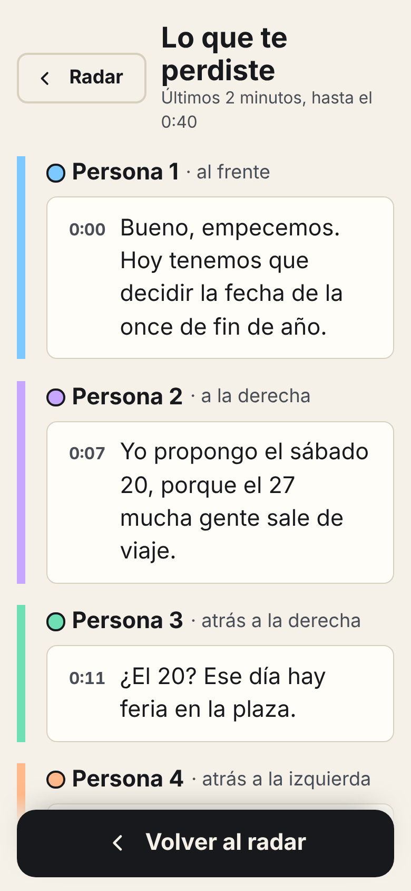
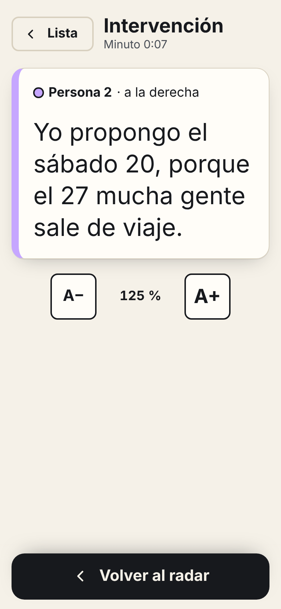
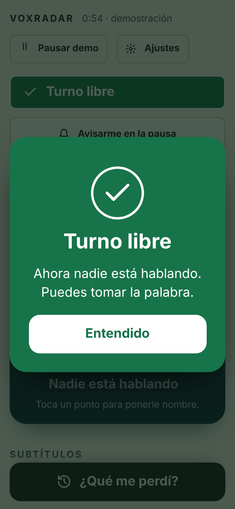
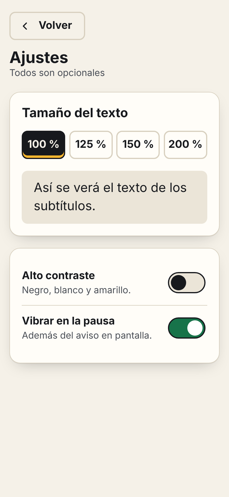

# VoxRadar

**Mira quién habla y no pierdas el hilo.** Prototipo navegable de media fidelidad para personas con hipoacusia que participan en reuniones grupales presenciales.

Proyecto de la asignatura *Interacción Humano Computador* — Universidad Mayor.

> **Prototipo:** usa una reunión de demostración con voces simuladas. No capta audio real.

## Qué permite hacer

| Tarea crítica | Cómo se hace en la app | Necesidad |
| --- | --- | --- |
| **T1.** Identificar quién habla y desde dónde | El radar marca al hablante con un punto más grande, anillo, ondas y su nombre. Se puede tocar un punto para ponerle nombre. | N1, N5 |
| **T2.** Recuperar lo que me perdí | Botón **"¿Qué me perdí?"**: lo dicho en los últimos 2 minutos, agrupado por hablante. Cada frase se puede ver en grande. | N2, N3 |
| **T3.** Saber cuándo intervenir | Indicador **"Alguien está hablando" / "Turno libre"** y aviso opcional **"Avisarme en la pausa"** (pantalla y vibración). | N4 |

## Pantallas

| 1. Inicio | 2. Radar | 3. Nombre | 4. ¿Qué me perdí? |
| --- | --- | --- | --- |
|  |  |  |  |

| 5. Detalle | 6. Turno libre | 7. Ajustes |
| --- | --- | --- |
|  |  |  |

## Decisiones de diseño

| Código | Decisión | Necesidad | Principio | Dónde está |
| --- | --- | --- | --- | --- |
| D1 | Hablante activo marcado por tamaño, anillo, ondas y nombre, no solo por color | N1 | WCAG 1.4.1; Heurística 1 | `src/ui/components/radar-view.js` |
| D2 | Subtítulos en bloques por hablante, con el nombre antes del texto | N3, N1 | WCAG 1.2.4 | `src/ui/components/captions.js` |
| D3 | Botón "¿Qué me perdí?" siempre visible, de 64 px de alto | N2 | Heurística 6; WCAG 2.5.8 | `src/ui/screens/radar.js`, `missed.js` |
| D4 | Indicador de turno con ícono + texto y aviso por vibración opcional | N4 | Heurística 1; WCAG 1.4.1 | `src/ui/components/turn-indicator.js`, `pause-alert.js` |
| D5 | Texto ampliable hasta 200 % y modo de alto contraste | N3, N5 | WCAG 1.4.4; 1.4.3 | `src/ui/screens/settings.js`, `detail.js` |
| D6 | Una sola acción para empezar, sin registro; ajustes opcionales | N6 | Heurísticas 7 y 8 | `src/ui/screens/home.js` |

Además: tipografía [Atkinson Hyperlegible](https://www.brailleinstitute.org/freefont/) (diseñada para baja visión), texto base de 18 px, objetivos táctiles de 48 px o más y anuncios para lectores de pantalla cuando cambia el hablante.

## Usarla

- **En línea:** se publica en GitHub Pages en cada cambio a `main` (ver más abajo).
- **Instalarla en el celular:** abrir el enlace y elegir *"Agregar a pantalla de inicio"*. Funciona sin conexión.

### Parámetros de demostración

| Parámetro | Ejemplo | Efecto |
| --- | --- | --- |
| `velocidad` | `?velocidad=4` | Acelera la reunión (1–20) |
| `t` | `?t=48` | Empieza en el segundo indicado |
| `congelar` | `?congelar=1` | Detiene el reloj (útil para capturas) |

Ejemplo: `…/?t=48#/radar` deja la reunión justo antes de una pausa para probar el aviso de turno libre.

## Desarrollo

Requiere Node.js 22 o superior. No hay paso de compilación: son HTML, CSS y módulos de JavaScript.

```bash
npm install            # solo instala Playwright para las pruebas E2E
npm start              # http://localhost:5173
npm test               # pruebas unitarias
npm run test:coverage  # pruebas unitarias con cobertura (mínimo 80 %)
npx playwright install chromium
npm run test:e2e       # pruebas de T1, T2, T3, diseño adaptable y accesibilidad
npm run screenshots    # regenera docs/capturas/
```

### Estructura

```text
src/
├── core/        lógica pura e inmutable (simulación, historial, nombres, ajustes)
├── app/         estado, guardado local, reloj y rutas
├── ui/
│   ├── components/   radar, indicador de turno, subtítulos, cabecera
│   └── screens/      las 7 pantallas
└── styles/      tokens de diseño y estilos
tests/
├── unit/        node:test
└── e2e/         Playwright
```

## Publicar en GitHub Pages

1. En el repositorio: **Settings → Pages → Source: GitHub Actions**.
2. Cada cambio en `main` ejecuta las pruebas y, si pasan, publica la app.
3. El enlace queda en **Settings → Pages** (formato `https://<usuario>.github.io/VoxRadar/`).

## Privacidad

La app no envía datos a ningún servidor. Los nombres y ajustes se guardan solo en el teléfono (`localStorage`).
